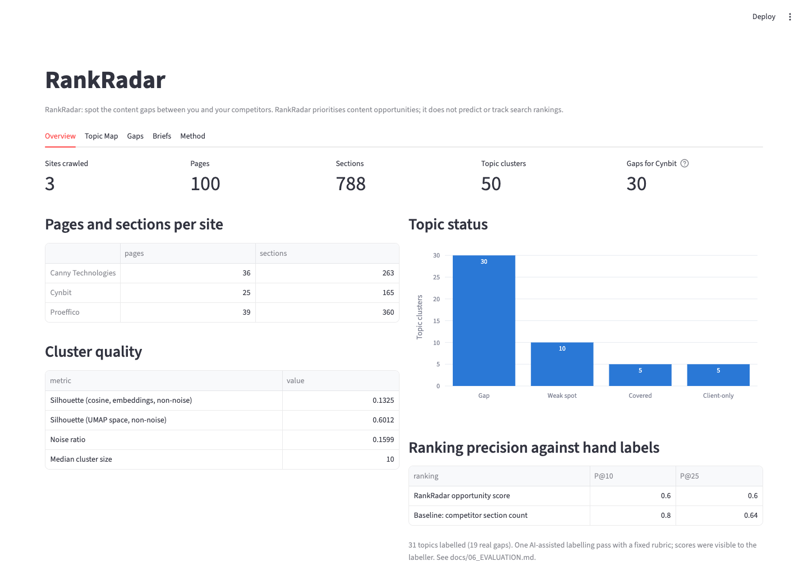
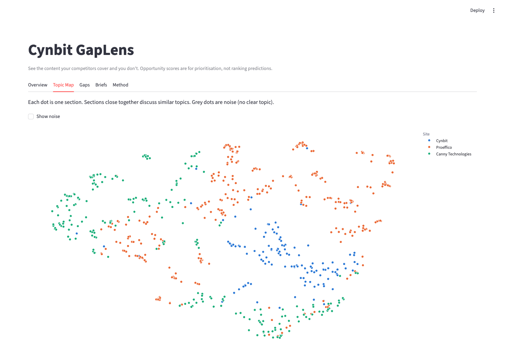

# Cynbit GapLens

> **See the content your competitors cover and you don't.**

GapLens is an AI content-gap and opportunity engine for Cynbit's SEO services. It politely crawls a client's blog and its competitors' blogs, splits every post into heading-level sections, embeds and clusters them by meaning, finds topics competitors cover but the client doesn't, ranks those gaps with a transparent opportunity score and writes grounded content briefs for human writers. It never generates or publishes articles.

I built it as a take-home assessment for the AI/ML Engineer Intern role at Cynbit Technologies, and demonstrated it on **Cynbit's own blog** against two competitor agencies.



**Live demo:** _add the Streamlit Community Cloud URL after deploying (steps below)._

## What it found

From the final run (`outputs/metrics.json`, 2026-10-29T17:35:44Z): 100 posts (Cynbit 25, Proeffico 39, Canny Technologies 36) were split into 788 sections and grouped into 50 topics. For Cynbit, 30 topics are **Gaps** and 10 are **Weak spots**.

**Ranking quality: the opportunity score did not beat a naive baseline.** On 31 labelled topics, Precision@10 was **0.60 vs 0.80** for ranking by competitor section count, and Precision@25 was **0.60 vs 0.64**. The labels come from one AI-assisted labelling pass that could see the scores, and the baseline still won.

The causes are known:
- Relevance is confounded with Cynbit's existing coverage.
- Site-level cluster splitting creates false gaps. Cynbit's small-business automation content is marked Covered, while its Proeffico-only twin is the #1 Gap.
- The coverage check affected effort, not gap status.

Details are in [`docs/06_EVALUATION.md`](docs/06_EVALUATION.md); the v2 plan is in [`docs/08_EXECUTION_PLAN.md`](docs/08_EXECUTION_PLAN.md).

The tool still surfaces useful topics. In the top 10, the labels confirm six, of which these five are the most concrete:

| Rank | Topic | Status | Score | Why it matters for Cynbit |
|---|---|---|---|---|
| 2 | AI logistics automation | Weak spot | 73.92 | Maps to the AI automation suite; Cynbit mentions logistics in one section only |
| 4 | WhatsApp chatbot automation | Weak spot | 71.73 | Maps to AI assistants and CRM automation; no Cynbit post on WhatsApp channels |
| 5 | AI implementation in Indian healthcare | Weak spot | 70.33 | A vertical for AI and document automation, covered by Cynbit only in passing |
| 7 | Cloud provider comparison (AWS vs Azure vs GCP) | Weak spot | 64.02 | Maps to cloud infrastructure and migration; Cynbit has one 137-word cloud post |
| 8 | Custom CRM vs Salesforce costs | Weak spot | 59.60 | Maps to custom software and CRM automation; no build-vs-buy cost post |

Ranks 1, 3, 6 and 9 were labelled "already covered" by existing Cynbit posts.



## Quickstart

Requires Python 3.10+ and works on CPU only. I developed and tested it on Python 3.13.

```bash
git clone <repo-url> gaplens-content-intelligence
cd gaplens-content-intelligence
python -m venv .venv
source .venv/bin/activate            # Windows: .venv\Scripts\activate
pip install -r requirements.txt
cp .env.example .env                 # optional: add NVIDIA_API_KEY from build.nvidia.com

# Full run: polite crawl (a few minutes), then the analysis
python -m gaplens.pipeline --config config.yaml

# Re-run the analysis on cached data, without an API key
python -m gaplens.pipeline --config config.yaml --skip-crawl --no-llm

# Dashboard (reads outputs/, so it works straight after cloning)
streamlit run app/streamlit_app.py

# Tests
pytest -q
```

Without `NVIDIA_API_KEY`, GapLens uses keyword topic labels and template briefs. Scores and rankings are identical either way.

## How it works

```
Crawl → Extract → Sectionize → Embed (bge-small) → UMAP → HDBSCAN → Label → Coverage & status → Score → Briefs → Dashboard
```

| Step | Choice |
|---|---|
| Crawl | robots.txt checked with its own User-Agent, 1.5 s delay, 60-post cap. Automely was skipped because its robots.txt was unreachable. |
| Topics | Heading-level sections, `BAAI/bge-small-en-v1.5` embeddings, UMAP + HDBSCAN (50 clusters, noise ratio 0.16) |
| Gaps | Gap = no client sections in a topic; Weak spot = client share < 20% with ≥ 3 competitor sections |
| Score | 100 × (0.40 relevance + 0.25 competitor strength + 0.20 intent + 0.15 (1 − effort)), with a plain-language reason per topic |
| Briefs | Nemotron via NVIDIA NIM, grounded in excerpts, schema-validated, copy-checked in code, template fallback |

## Project structure

```
├── app/streamlit_app.py          # dashboard (reads outputs/ only)
├── app/requirements.txt          # slim dependencies for Streamlit Community Cloud
├── config.yaml                   # sites, crawl limits, model, thresholds, weights
├── data/client_services.txt      # Cynbit's service descriptions (relevance)
├── data/labels/                  # hand-label template and filled labels
├── docs/                         # brief, SRS, architecture, design docs, ADRs
├── notebooks/gaplens_walkthrough.ipynb
├── outputs/                      # gaps.csv, briefs.json, metrics.json, figures, topic_map.parquet
├── reports/                      # Deliverables 1 and 3
├── src/gaplens/                  # crawl, sectionize, embed, cluster, label, llm, gaps, score, briefs, evaluate, pipeline
└── tests/test_basic.py
```

Crawled text and intermediate files (`data/raw/`, `data/processed/`) are not committed, so competitor content is not redistributed. A full run regenerates them.

## Deliverables

| Deliverable | Where |
|---|---|
| 1. AI opportunity analysis | [`reports/AI_OPPORTUNITY_REPORT.md`](reports/AI_OPPORTUNITY_REPORT.md) |
| 2. Proof of concept | `src/gaplens/`, [`app/streamlit_app.py`](app/streamlit_app.py), [`notebooks/gaplens_walkthrough.ipynb`](notebooks/gaplens_walkthrough.ipynb) |
| 3. Technical approach | [`reports/TECHNICAL_APPROACH_REPORT.md`](reports/TECHNICAL_APPROACH_REPORT.md) |

## Documentation (reading order)

0. [Project brief](docs/00_PROJECT_BRIEF.md)
1. [Software requirements specification](docs/01_SRS.md)
2. [Architecture](docs/02_ARCHITECTURE.md)
3. [Data pipeline](docs/03_DATA_PIPELINE.md)
4. [Modeling and scoring](docs/04_MODELING_AND_SCORING.md)
5. [Prompt design](docs/05_PROMPT_DESIGN.md)
6. [Evaluation](docs/06_EVALUATION.md)
7. [Risks and ethics](docs/07_RISKS_AND_ETHICS.md)
8. [Execution plan](docs/08_EXECUTION_PLAN.md)
9. [Decision records](docs/DECISIONS.md)

## Limitations

- **The ranking did not beat a naive baseline** (Precision@10 0.60 vs 0.80; Precision@25 0.60 vs 0.64). Coverage must become a hard gate and topics must be aligned across sites before the ranking goes in front of clients.
- **Two competitors, about 100 posts**, all public. There is no search volume, keyword difficulty or Search Console data yet, so "opportunity" is a proxy, not a traffic forecast.
- **The labels have limits.** They come from one AI-assisted labelling pass with a fixed rubric: 31 rows, scores visible to the labeller, 0 human overrides.
- **Single-site clusters.** Most clusters are dominated by one site's writing, so some "gaps" are one agency's niche.
- **The opportunity score is for prioritisation only.** It does not predict Google rankings.

## Deploying the dashboard to Streamlit Community Cloud

1. Push this repository to GitHub.
2. At share.streamlit.io, choose **Create app → Deploy a public app from GitHub**, then pick the repository, branch `main` and main file `app/streamlit_app.py`.
3. Under **Advanced settings**, choose Python 3.12 or 3.13. Community Cloud installs `app/requirements.txt` (next to the entrypoint) rather than the full root requirements.
4. Optionally, under **Advanced settings → Secrets**, add:
   ```toml
   NVIDIA_API_KEY = "nvapi-..."
   ```
   The dashboard itself reads precomputed outputs and makes no LLM calls, so the key only matters if you later run the pipeline in the cloud.
5. Deploy, then put the app URL in the "Live demo" line above.

## Author

Gokul Mallabathula, built for the Cynbit Technologies AI/ML Engineer Intern assessment.
