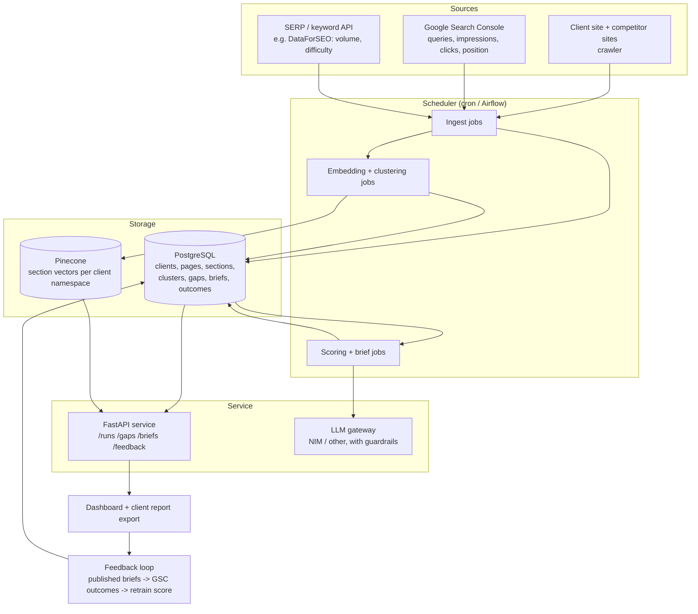

# 02 — Architecture: RankRadar

## 1. Pipeline overview (PoC)

```mermaid
flowchart LR
    CFG[config.yaml] --> A
    A[Crawl<br/>robots.txt, delay, cap] --> B[Extract<br/>trafilatura / BS4]
    B --> C[Sectionize<br/>heading-level, dedupe boilerplate]
    C --> D[Embed<br/>bge-small-en-v1.5]
    D --> E[Reduce<br/>UMAP cosine]
    E --> F[Cluster<br/>HDBSCAN, noise = -1]
    F --> G[Label<br/>KeyBERT/TF-IDF + optional LLM]
    G --> H[Coverage & Gap Detection<br/>Gap / Weak spot / Covered / Client-only]
    SVC[Client service text] --> I
    H --> I[Score<br/>weighted, 0-100 + reason]
    I --> J[Briefs<br/>Nemotron via NIM, template fallback]
    J --> K[(Outputs<br/>gaps.csv, briefs.json,<br/>metrics.json, figures)]
    K --> L[Streamlit dashboard]
    K --> M[Evaluation<br/>silhouette, P@10/P@25]
```

Every stage writes its result to disk. This keeps stages independently re-runnable (`--skip-crawl`), makes debugging easy, and lets the dashboard load precomputed files without running any models.

## 2. Components

| Module | Responsibility | Inputs | Outputs | Key libraries |
|---|---|---|---|---|
| `config.py` | Load and validate `config.yaml`, load `.env`. | `config.yaml`, `.env` | Config object | `pyyaml`, `python-dotenv` |
| `crawl.py` | Check robots.txt, discover post URLs from listings, fetch politely, extract text and headings. | Site configs | `data/raw/pages.jsonl`, crawl log | `requests`, `urllib.robotparser`, `trafilatura`, `beautifulsoup4` |
| `sectionize.py` | Split pages by headings, merge/split by length, remove repeated boilerplate. | `pages.jsonl` | `sections.parquet` | `pandas` |
| `embed.py` | Encode sections into normalised vectors; cache. | `sections.parquet` | `embeddings.npy` | `sentence-transformers` |
| `cluster.py` | UMAP reduction, HDBSCAN clustering, 2-D projection for plotting, cluster metrics. | Embeddings | `clusters.parquet`, metrics | `umap-learn`, `hdbscan`, `scikit-learn` |
| `label.py` | Keywords per cluster; optional LLM topic name. | Clusters, sections | Cluster labels | `keybert`, `scikit-learn` |
| `llm.py` | OpenAI-compatible client for NVIDIA NIM: backoff, JSON parsing, token and latency stats. | Prompts | Parsed replies, call stats | `openai` |
| `gaps.py` | Per-cluster coverage and status. | Clusters, sections | Coverage table | `pandas` |
| `score.py` | Relevance, competitor strength, intent, effort; weighted score; reason; sensitivity check. | Coverage, embeddings, service text | `gaps.csv` | `numpy`, `pandas` |
| `briefs.py` | Grounded briefs for top-N gaps with validation, retry and template fallback. | Top gaps, sections | `briefs.json` | `openai` (NIM endpoint) |
| `evaluate.py` | Cluster metrics, hand-label template, precision vs baseline, runtime, figures. | All outputs, labels | `metrics.json`, `figures/`, label template | `scikit-learn`, `plotly` |
| `pipeline.py` | CLI orchestrating all stages with timing; `--skip-crawl`, `--no-llm`. | `config.yaml` | All of the above | `argparse` |
| `app/streamlit_app.py` | Overview, Topic Map, Gaps, Briefs, Method (live weights). | Precomputed outputs | Web UI | `streamlit`, `plotly` |

## 3. Data contracts

### 3.1 `data/raw/pages.jsonl` (one JSON object per line)

| Field | Type | Notes |
|---|---|---|
| `page_id` | str | SHA-1 of the normalised URL (first 12 chars) |
| `url` | str | Canonical post URL |
| `site` | str | Site name from config, e.g. `Cynbit` |
| `role` | str | `client` or `competitor` |
| `title` | str | Page title / H1 |
| `headings` | list[{`level`: int, `text`: str}] | H1–H3 in document order |
| `text` | str | Extracted main text (markdown-like, headings preserved as `#` lines) |
| `word_count` | int | Words in `text` |
| `fetched_at` | str | ISO-8601 UTC timestamp |

### 3.2 `data/processed/sections.parquet`

| Column | Type | Notes |
|---|---|---|
| `section_id` | str | `{page_id}-{position}` |
| `page_id` | str | FK to pages |
| `url` | str | |
| `site` | str | |
| `role` | str | `client` / `competitor` |
| `page_title` | str | |
| `heading` | str | Section heading (page title for the intro section) |
| `position` | int | Order within the page |
| `text` | str | Section body; the embedded text is `heading + text` |
| `word_count` | int | |

`data/processed/embeddings.npy`: float32 array of shape `(n_sections, dim)`, row-aligned with `sections.parquet`.

### 3.3 `data/processed/clusters.parquet`

| Column | Type | Notes |
|---|---|---|
| `section_id` | str | FK to sections |
| `cluster_id` | int | `-1` = noise |
| `probability` | float | HDBSCAN membership strength |
| `x`, `y` | float | 2-D UMAP projection for plotting |

### 3.4 `outputs/gaps.csv` (one row per non-noise cluster, sorted by `score` descending)

| Column | Type | Notes |
|---|---|---|
| `cluster_id` | int | |
| `label` | str | LLM topic name if available, else top keywords |
| `top_keywords` | str | Comma-separated |
| `status` | str | `Gap`, `Weak spot`, `Covered`, `Client-only` |
| `n_sections` | int | |
| `client_sections` | int | |
| `competitor_sections` | int | |
| `competitors_covering` | int | Distinct competitor sites |
| `client_share` | float | 0–1 |
| `relevance` | float | 0–1, centroid vs service text (min-max scaled) |
| `relevance_raw` | float | Cosine similarity before scaling |
| `competitor_strength` | float | 0–1 |
| `intent` | str | `informational`, `commercial`, `transactional` |
| `intent_score` | float | 0–1 |
| `effort` | float | 0 = expand an existing page, 1 = new page |
| `score` | float | 0–100; empty for Covered / Client-only |
| `reason` | str | Plain-language explanation of the score |
| `closest_client_url` | str | Nearest client page (internal link candidate) |
| `closest_client_similarity` | float | Cosine similarity |
| `closest_service` | str | Service sentence closest to the topic |
| `competitor_urls` | str | Pipe-separated competitor URLs in the cluster |
| `sites` | str | Section count per site, e.g. `Proeffico: 14, Cynbit: 1` |
| `sample_excerpt` | str | Most representative section excerpt |

### 3.5 `outputs/briefs.json` (list of objects)

| Field | Type |
|---|---|
| `cluster_id` | int |
| `topic` | str |
| `why_it_matters` | str |
| `target_intent` | str |
| `suggested_title` | str |
| `outline` | list[{`h2`: str, `h3`: list[str]}] |
| `questions_to_answer` | list[str] |
| `competitor_reference_urls` | list[str] |
| `internal_link_from` | str |
| `opportunity_score` | float |
| `status` | str (`Gap` or `Weak spot`) |
| `source` | str (`llm` or `template`) |
| `model` | str or null |
| `llm_attempts` | int (0 without an LLM) |
| `validation_failures` | list[str] (why earlier attempts were rejected) |

### 3.6 `outputs/metrics.json`

Cluster metrics (silhouette, noise ratio, cluster count, size distribution), per-site page and section counts, sensitivity check, precision results with label provenance, ablation and error analysis (once labels exist), LLM call stats and runtime per stage.

### 3.7 Other files

- `outputs/topic_map.parquet`: one row per section with site, cluster, 2-D coordinates, label, status, score and a 40-word excerpt; read by the dashboard.
- `data/labels/gap_labels_template.csv`: topics to label (`is_real_gap` blank). `data/labels/gap_labels_filled.csv`: the filled labels used for evaluation, with `confidence` and `label_source`.

## 4. PoC vs production architecture

The PoC is file-based and runs as a batch job. A production version for Cynbit's SEO retainers adds first-party performance data, keyword data, persistent storage, an API and a feedback loop:

Python, FastAPI, PostgreSQL and Pinecone are all listed in the technology stack on Cynbit's services page (https://www.cynbit.in/services), so the production design reuses tools the team already works with.

Key production differences:

- **Real demand signals.** Search Console and keyword volume/difficulty replace the competitor-coverage proxy as the main demand signal.
- **Persistence and history.** Runs are stored per client so gaps can be tracked over time ("closed since last quarter").
- **Feedback loop.** Once briefs are published, their Search Console performance becomes the outcome label for a supervised opportunity model (see `04_MODELING_AND_SCORING.md`).
- **Multi-tenancy and access control.** Client Search Console data is private and must be isolated per client.

## 5. Design decisions

The main decisions are recorded as short ADRs in [`DECISIONS.md`](DECISIONS.md):

1. Sentence-transformers instead of paid embedding APIs.
2. UMAP + HDBSCAN instead of k-means.
3. Heading-level sections instead of whole pages.
4. A transparent weighted score instead of a trained model.
5. LLM optional, with a keyword fallback.
6. Briefs for humans, not generated articles.
7. Nemotron 3.5 Super, because the planned model was delisted.
8. Opportunity scores do not depend on the LLM.
9. The project is named RankRadar (renamed from its working name).
