# Technical Approach Report: GapLens

*Deliverable 3, AI/ML Engineer Intern assessment. A condensed version of `docs/02`–`docs/08`; follow the links for detail.*

## 1. What GapLens does

GapLens takes a client website and competitor websites, crawls their public blog posts, groups the content into topics by meaning, finds topics competitors cover that the client does not, ranks them with a transparent opportunity score and writes grounded content briefs for human writers. The demo runs on Cynbit's own blog against Proeffico and Canny Technologies.

## 2. Architecture

```mermaid
flowchart LR
    CFG[config.yaml] --> A
    A[Crawl<br/>robots.txt, 1.5 s delay, 60-post cap] --> B[Extract<br/>trafilatura / BS4]
    B --> C[Sectionize<br/>heading-level, boilerplate removed]
    C --> D[Embed<br/>bge-small-en-v1.5]
    D --> E[UMAP<br/>cosine, seed 42]
    E --> F[HDBSCAN<br/>noise = -1]
    F --> G[Label<br/>c-TF-IDF + KeyBERT, Nemotron names]
    G --> H[Coverage and status<br/>Gap / Weak spot / Covered / Client-only]
    SVC[Cynbit service text] --> I
    H --> I[Opportunity score<br/>0-100 + reason]
    I --> J[Briefs<br/>Nemotron, validated, copy-checked]
    J --> K[(gaps.csv, briefs.json,<br/>metrics.json, figures)]
    K --> L[Streamlit dashboard]
```



Every stage writes to disk, so stages can be re-run independently and the dashboard reads only precomputed files. The production design adds Google Search Console, a keyword/SERP API, PostgreSQL and Pinecone, a FastAPI service, scheduling and an outcome feedback loop: [`docs/02_ARCHITECTURE.md`](../docs/02_ARCHITECTURE.md) §4.

## 3. Data pipeline

| Step | Result |
|---|---|
| Sources | Cynbit (client, 25 posts), Proeffico (39), Canny Technologies (36). Automely skipped: its robots.txt was unreachable, which RFC 9309 treats as a disallow. |
| Crawl policy | Own User-Agent, robots.txt checked for every URL, 1.5 s delay, 60-post cap, public posts only |
| Extraction | trafilatura with a BeautifulSoup fallback (used for 69 of 100 pages, mainly where trafilatura dropped headings), plus recovery of flattened markdown headings and charset fixes |
| Sections | Split at H2/H3; under 60 words merged, over 350 split; page furniture and repeated boilerplate removed. 788 sections (Cynbit 165, Proeffico 360, Canny 263). |

Details: [`docs/03_DATA_PIPELINE.md`](../docs/03_DATA_PIPELINE.md).

## 4. Model choices

| Component | Choice | Why | Alternative considered |
|---|---|---|---|
| Text unit | Heading-level sections | Posts mix subtopics; gaps appear at subtopic level | Whole pages; fixed token windows |
| Embeddings | `BAAI/bge-small-en-v1.5`, normalised | Good quality for its size, CPU-friendly, free and offline | Paid embedding APIs; larger local models |
| Reduction | UMAP, 10-d, cosine, `n_neighbors=15`, `min_dist=0`, seed 42 | Keeps structure for density clustering; reproducible | PCA |
| Clustering | HDBSCAN, `min_cluster_size=5`, `min_samples=3` | No preset k; explicit noise label | k-means; agglomerative; BERTopic |
| Keywords | c-TF-IDF candidates re-ranked by KeyBERT (MMR) | Distinctive per cluster, not just frequent | Plain TF-IDF; KeyBERT alone |
| Topic names, briefs | `nvidia/nemotron-3.5-super-vl-120b-a12b` via NIM, reasoning off | The planned 49B Super model is delisted; this was the closest working Super model | Nemotron 3 Ultra (larger and slower) |
| Ranking | Transparent weighted score | No outcome labels yet; explainable | Supervised model (planned once outcomes exist) |

Decision records: [`docs/DECISIONS.md`](../docs/DECISIONS.md) (ADR-001 to ADR-008).

**Clustering results:** 50 clusters, noise ratio 0.16, median cluster size 10. Silhouette is 0.6012 in UMAP space and 0.1325 on the original embeddings (cosine). Clusters separate clearly after reduction, but only weakly in the raw space.

## 5. Gap detection and scoring

- **Gap:** no Cynbit sections in the cluster. **Weak spot:** Cynbit share < 20% while competitors have ≥ 3 sections. Result: 30 Gaps, 10 Weak spots, 5 Covered, 5 Client-only.
- **Score** (0–100) = 100 × (0.40·relevance + 0.25·competitor strength + 0.20·intent + 0.15·(1 − effort)).
  - **Relevance:** similarity between the topic centroid and the closest sentence of Cynbit's service text.
  - **Competitor strength:** how many competitors cover the topic, and how much.
  - **Intent:** keyword rules; transactional 1.0, commercial 0.7, informational 0.4.
  - **Effort:** 0 if a Cynbit section is already close to the topic; the threshold is auto-calibrated to 0.8483.
- **Every row has a plain-language `reason`.** Scores never depend on the LLM (ADR-008).
- **Sensitivity:** under ±0.1 shifts of any weight, the top 10 keeps 9.88 topics on average (minimum 9).

Details: [`docs/04_MODELING_AND_SCORING.md`](../docs/04_MODELING_AND_SCORING.md).

## 6. Prompt engineering

- **Two prompts:** a 2–6-word topic name per cluster, and a brief for each of the top 10 gaps. The exact text is in [`docs/05_PROMPT_DESIGN.md`](../docs/05_PROMPT_DESIGN.md).
- **Grounding:** the model sees only short competitor excerpts from that cluster and Cynbit's service summary. URLs, the internal link and the score are filled in by code.
- **Guardrails:** no invented statistics, no copying and no ranking promises in the prompt, plus schema validation and a **code-level 8-word copy check**, one retry with feedback, and a template fallback. The copy check exists because a pre-release brief copied competitor sentences despite the prompt.
- **Final run:** 61 calls, 48,939 prompt and 6,555 completion tokens, mean latency 2.27 s. 10 of 10 briefs came from the LLM; 1 retry was triggered by the copy check, and the retry passed. A post-run audit against all competitor text found no shared 8-word sequence.

## 7. Evaluation

| Ranking (31 AI-assisted hand labels) | Precision@10 | Precision@25 |
|---|---|---|
| GapLens opportunity score | 0.60 | 0.60 |
| Baseline: competitor section count | 0.80 | 0.64 |

**GapLens did not beat the baseline on these labels.** The error analysis shows why.

- **All four top-10 false positives are topics Cynbit already covers.** The Gap rule counts sections per cluster, and Cynbit's sections on those subjects landed in neighbouring clusters. For example, "AI automation for small businesses" is Covered, while "AI business automation benefits" is the #1 Gap.
- **Relevance amplifies the problem.** The topics closest to Cynbit's services are the ones it already writes about. Removing relevance in a post-hoc ablation raises Precision@10 to 0.70.
- **The labels have limits.** They come from one AI labeller with a fixed rubric, blind to scores, with 0 human overrides. The sample is small, and there is no traffic data.
- **The proposed fix:** page-level coverage detection, relevance used as a gate rather than a weight, then re-evaluation on fresh labels, ideally from two human labellers. After that, an online test with a pilot client: publish briefs for high- and low-scored topics and compare Search Console outcomes over 8–12 weeks.

**Runtime:** 167.81 s excluding the crawl (embedding 19.4 s, LLM labels 48.95 s, LLM briefs 92.64 s), well under the 10-minute requirement.

Details: [`docs/06_EVALUATION.md`](../docs/06_EVALUATION.md).

## 8. Risks

The main risks, with mitigations ([`docs/07_RISKS_AND_ETHICS.md`](../docs/07_RISKS_AND_ETHICS.md)):

- **Scaled content abuse:** briefs only, no publishing.
- **Copyright:** a code-level copy check, and no full competitor text committed.
- **Crawling etiquette:** robots.txt, delay, cap and an identifiable User-Agent.
- **Hallucination:** grounding, code-filled facts and an audit trail per brief.
- **Subjective weights:** config, live sliders, a sensitivity check and an honest baseline comparison.
- **API dependence:** the LLM is optional, and the model id is configurable.
- **Client data privacy in production:** OAuth, per-client isolation and DPDP alignment.

## 9. Execution plan

| Phase | Scope | Time |
|---|---|---|
| A (done) | PoC on public data | — |
| B | Fix coverage detection; pilot with one SEO client with Search Console and keyword data; start the online test | 2–4 weeks |
| C | FastAPI service, PostgreSQL + Pinecone, monthly scheduled runs, client reports | 1–2 months |
| D | Content refresh module ("what to fix"), building on a client-grouped Random Forest refresh model I built previously (ROC-AUC 0.955 vs 0.687 rule baseline) | 3–4 weeks |
| E | Supervised opportunity model on pilot outcomes, client-grouped validation | after one quarter of outcomes |

Details: [`docs/08_EXECUTION_PLAN.md`](../docs/08_EXECUTION_PLAN.md).

## 10. How to run the PoC

```bash
git clone <repo-url> gaplens-content-intelligence
cd gaplens-content-intelligence
python -m venv .venv && source .venv/bin/activate      # Python 3.10+
pip install -r requirements.txt
cp .env.example .env            # optional: add NVIDIA_API_KEY for LLM labels and briefs

python -m gaplens.pipeline --config config.yaml              # full run, including the crawl
python -m gaplens.pipeline --config config.yaml --skip-crawl --no-llm   # re-run on cached data, no API key
streamlit run app/streamlit_app.py                           # dashboard over outputs/
pytest -q                                                    # tests
```

The repository ships the outputs of the final run, so the dashboard works immediately after cloning. `notebooks/gaplens_walkthrough.ipynb` is committed with its outputs, so it can be read straight away; re-executing it needs one pipeline run first, because crawled text is not committed.
